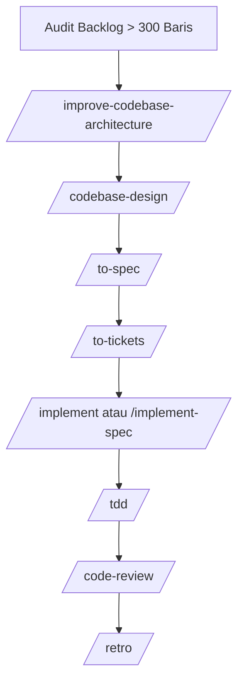

# Audit Komprehensif Berkas > 300 Baris & Peta Alur Kerja (Ask Matt)

> **Status Repositori:** Bersih dari pelanggaran keras (> 500 baris kode aplikasi).
> **Tujuan Dokumen:** Inventaris 100% lengkap dari seluruh 82 berkas di repositori yang memiliki > 300 baris (baik baris kode bermakna maupun total baris mentah) agar tidak ada file yang terlewat dalam kampanye refaktorisasi.

---

## 1. Peta Navigasi Alur Kerja (Ask Matt Flow)

Sesuai prinsip **Ask Matt**, pemeliharaan dan refaktorisasi arsitektur codebase ini dipetakan ke alur berikut:

- **`/improve-codebase-architecture`**: Digunakan saat pemeliharaan kesehatan codebase untuk mengangkat peluang perbaikan (*deepening opportunities*).
- **`/codebase-design`**: Kosa kata desain modul mendalam (*deep modules, small interface, clean seams*) agar pemecahan tidak menambah layer dangkal.
- **`/to-tickets`**: Memecah rencana gelombang refaktorisasi menjadi tiket-tiket kecil mandiri (*tracer-bullet tickets*) dengan batas ketergantungan jelas.

---

## 2. Ringkasan Eksekutif (82 Berkas > 300 Baris)

| Kategori | > 300 Baris Kode | 200–300 Baris Kode (Raw > 300) | Total Berkas | Keterangan Tindakan |
|---|:---:|:---:|:---:|---|
| **Controller API (`app/Http/Controllers/`)** | 6 | 8 | **14** | Wajib evaluasi sub-domain |
| **Komponen Livewire (`app/Livewire/`)** | 11 | 10 | **21** | Ekstrak Form & Concerns UI |
| **Layanan Domain (`app/Services/`)** | 0 | 1 | **1** | Mandiri & kohesif |
| **Template Blade (`resources/views/`)** | 16 | 7 | **23** | Ekstrak modal ke `partials/` |
| **Pengujian Fitur (`tests/`)** | 7 | 4 | **11** | *Dikecualikan (Rule 2 - Verifikasi)* |
| **Database Seeders (`database/`)** | 6 | 2 | **8** | *Dikecualikan (Rule 2 - Data Statis)* |
| **Dokumentasi Proyek (`docs/`)** | 2 | 1 | **3** | *Dikecualikan (Rule 2 - Teks PRD/UAT)* |
| **TOTAL KESELURUHAN** | **49** | **33** | **82** | |

---

## 3. Controller API (`app/Http/Controllers/`) (14 Berkas)

Controller yang menangani rute API v1. Yang memiliki > 300 baris kode mencampur beberapa sub-domain atau aksi operasional.

| No | Baris Kode | Baris Raw | Path Berkas | Status Prioritas |
|:---:|:---:|:---:|---|:---:|
| 1 | **444** | 548 | `app/Http/Controllers/Api/V1/PengadaanApiController.php` | Prioritas Tinggi (Kode > 300) |
| 2 | **427** | 511 | `app/Http/Controllers/Api/V1/MaintenanceSpkApiController.php` | Prioritas Tinggi (Kode > 300) |
| 3 | **367** | 440 | `app/Http/Controllers/Api/V1/AsetPengalihanApiController.php` | Prioritas Tinggi (Kode > 300) |
| 4 | **312** | 374 | `app/Http/Controllers/Api/V1/AuditForensikApiController.php` | Prioritas Tinggi (Kode > 300) |
| 5 | **310** | 379 | `app/Http/Controllers/Api/V1/IpsrsApiController.php` | Prioritas Tinggi (Kode > 300) |
| 6 | **309** | 350 | `app/Http/Controllers/Api/V1/AsetKatalogApiController.php` | Prioritas Tinggi (Kode > 300) |
| 7 | **289** | 353 | `app/Http/Controllers/Api/V1/GudangTataLetakApiController.php` | Evaluasi (Raw > 300) |
| 8 | **284** | 348 | `app/Http/Controllers/Api/V1/DistribusiAmprahApiController.php` | Evaluasi (Raw > 300) |
| 9 | **282** | 353 | `app/Http/Controllers/Api/V1/ApprovalController.php` | Evaluasi (Raw > 300) |
| 10 | **282** | 342 | `app/Http/Controllers/Api/V1/MaintenanceTiketApiController.php` | Evaluasi (Raw > 300) |
| 11 | **261** | 320 | `app/Http/Controllers/Api/V1/GudangPengalihanBarangApiController.php` | Evaluasi (Raw > 300) |
| 12 | **248** | 310 | `app/Http/Controllers/Api/V1/DistribusiPengirimanApiController.php` | Evaluasi (Raw > 300) |
| 13 | **245** | 302 | `app/Http/Controllers/Api/V1/AuditTemuanApiController.php` | Evaluasi (Raw > 300) |
| 14 | **240** | 302 | `app/Http/Controllers/Api/V1/AsetPeminjamanApiController.php` | Evaluasi (Raw > 300) |

---

## 4. Komponen Livewire (`app/Livewire/`) (21 Berkas)

Komponen controller antarmuka web. Sebagian masih menumpuk kueri antrean, form wizard, dan logika otorisasi.

| No | Baris Kode | Baris Raw | Path Berkas | Status Prioritas |
|:---:|:---:|:---:|---|:---:|
| 1 | **488** | 578 | `app/Livewire/Aset/PeminjamanAsetIndex.php` | Prioritas Tinggi (Kode > 300) |
| 2 | **458** | 537 | `app/Livewire/Aset/PengalihanAsetIndex.php` | Prioritas Tinggi (Kode > 300) |
| 3 | **425** | 495 | `app/Livewire/Persediaan/PengalihanBarangIndex.php` | Prioritas Tinggi (Kode > 300) |
| 4 | **404** | 490 | `app/Livewire/User/PenggunaIndex.php` | Prioritas Tinggi (Kode > 300) |
| 5 | **403** | 490 | `app/Livewire/Distribusi/StokRuanganIndex.php` | Prioritas Tinggi (Kode > 300) |
| 6 | **377** | 445 | `app/Livewire/Master/AsetIndex.php` | Prioritas Tinggi (Kode > 300) |
| 7 | **353** | 442 | `app/Livewire/Pengadaan/PermintaanPengadaanIndex.php` | Prioritas Tinggi (Kode > 300) |
| 8 | **334** | 407 | `app/Livewire/Distribusi/PermintaanBarangIndex.php` | Prioritas Tinggi (Kode > 300) |
| 9 | **334** | 395 | `app/Livewire/Pengadaan/PenerimaanPoIndex.php` | Prioritas Tinggi (Kode > 300) |
| 10 | **321** | 393 | `app/Livewire/Persediaan/StockOpnameIndex.php` | Prioritas Tinggi (Kode > 300) |
| 11 | **318** | 389 | `app/Livewire/Ipsrs/LembarKerjaPengerjaanIndex.php` | Prioritas Tinggi (Kode > 300) |
| 12 | **300** | 402 | `app/Livewire/Aset/ApprovalPeminjamanIndex.php` | Evaluasi (Raw > 300) |
| 13 | **297** | 339 | `app/Livewire/Aset/Concerns/HasPenyediaPengalihan.php` | Evaluasi (Raw > 300) |
| 14 | **290** | 336 | `app/Livewire/Master/BarangIndex.php` | Evaluasi (Raw > 300) |
| 15 | **272** | 346 | `app/Livewire/Aset/PengembalianPeminjamanIndex.php` | Evaluasi (Raw > 300) |
| 16 | **271** | 334 | `app/Livewire/Distribusi/PickingDistribusiIndex.php` | Evaluasi (Raw > 300) |
| 17 | **269** | 332 | `app/Livewire/Ipsrs/PemeliharaanBerkalaIndex.php` | Evaluasi (Raw > 300) |
| 18 | **263** | 320 | `app/Livewire/Audit/RegisterTemuanCapaIndex.php` | Evaluasi (Raw > 300) |
| 19 | **263** | 306 | `app/Livewire/Aset/Concerns/HasPenyediaPeminjaman.php` | Evaluasi (Raw > 300) |
| 20 | **260** | 325 | `app/Livewire/Ipsrs/LaporServisIndex.php` | Evaluasi (Raw > 300) |
| 21 | **242** | 324 | `app/Livewire/User/RoleManager.php` | Evaluasi (Raw > 300) |

---

## 5. Layanan Domain (`app/Services/`) (1 Berkas)

Layer logika bisnis murni. Berkas di bawah ini memiliki komentar dokumentasi panjang sehingga baris mentahnya melebihi 300.

| No | Baris Kode | Baris Raw | Path Berkas | Status Prioritas |
|:---:|:---:|:---:|---|:---:|
| 1 | **261** | 324 | `app/Services/Persediaan/PengalihanBarangService.php` | Evaluasi (Raw > 300) |

---

## 6. Tampilan Template Blade (`resources/views/`) (23 Berkas)

Template Blade Livewire. Berkas dengan > 300 baris kode umumnya menumpuk tabel utama dengan 2 s.d. 4 modal dialog inline.

| No | Baris Kode | Baris Raw | Path Berkas | Status Prioritas |
|:---:|:---:|:---:|---|:---:|
| 1 | **494** | 539 | `resources/views/livewire/user/pengguna-index.blade.php` | Prioritas Tinggi (Kode > 300) |
| 2 | **485** | 545 | `resources/views/livewire/persediaan/pengalihan-barang-index.blade.php` | Prioritas Tinggi (Kode > 300) |
| 3 | **451** | 509 | `resources/views/livewire/audit/register-temuan-capa-index.blade.php` | Prioritas Tinggi (Kode > 300) |
| 4 | **446** | 501 | `resources/views/livewire/distribusi/permintaan-barang-index.blade.php` | Prioritas Tinggi (Kode > 300) |
| 5 | **434** | 498 | `resources/views/layouts/portal.blade.php` | Prioritas Tinggi (Kode > 300) |
| 6 | **417** | 467 | `resources/views/livewire/ipsrs/lembar-kerja-pengerjaan-index.blade.php` | Prioritas Tinggi (Kode > 300) |
| 7 | **411** | 466 | `resources/views/livewire/ipsrs/daftar-spk-perbaikan-index.blade.php` | Prioritas Tinggi (Kode > 300) |
| 8 | **406** | 472 | `resources/views/livewire/aset/pengembalian-peminjaman-index.blade.php` | Prioritas Tinggi (Kode > 300) |
| 9 | **404** | 440 | `resources/views/livewire/pengadaan/realisasi-anggaran-index.blade.php` | Prioritas Tinggi (Kode > 300) |
| 10 | **391** | 444 | `resources/views/livewire/persediaan/stock-opname-index.blade.php` | Prioritas Tinggi (Kode > 300) |
| 11 | **385** | 428 | `resources/views/livewire/distribusi/picking-distribusi-index.blade.php` | Prioritas Tinggi (Kode > 300) |
| 12 | **376** | 428 | `resources/views/livewire/ipsrs/lapor-servis-index.blade.php` | Prioritas Tinggi (Kode > 300) |
| 13 | **363** | 408 | `resources/views/livewire/pengadaan/permintaan-pengadaan-index.blade.php` | Prioritas Tinggi (Kode > 300) |
| 14 | **346** | 377 | `resources/views/livewire/distribusi/distribusi-approval-index.blade.php` | Prioritas Tinggi (Kode > 300) |
| 15 | **342** | 392 | `resources/views/livewire/distribusi/stok-ruangan-index.blade.php` | Prioritas Tinggi (Kode > 300) |
| 16 | **303** | 333 | `resources/views/livewire/aset/approval-peminjaman-index.blade.php` | Prioritas Tinggi (Kode > 300) |
| 17 | **295** | 337 | `resources/views/livewire/audit/pemeriksaan-selisih-opname-index.blade.php` | Evaluasi (Raw > 300) |
| 18 | **294** | 324 | `resources/views/livewire/pengadaan/pesanan-pembelian-index.blade.php` | Evaluasi (Raw > 300) |
| 19 | **290** | 341 | `resources/views/livewire/aset/peminjaman-aset-index.blade.php` | Evaluasi (Raw > 300) |
| 20 | **286** | 320 | `resources/views/livewire/aset/pengalihan-aset-index.blade.php` | Evaluasi (Raw > 300) |
| 21 | **279** | 313 | `resources/views/livewire/system/scheduler-notifikasi-index.blade.php` | Evaluasi (Raw > 300) |
| 22 | **275** | 303 | `resources/views/livewire/master/partials/barang/modal-detail-barang.blade.php` | Evaluasi (Raw > 300) |
| 23 | **264** | 303 | `resources/views/livewire/persediaan/monitoring-stok-fefo-index.blade.php` | Evaluasi (Raw > 300) |

---

## 7. Berkas Pengujian Fitur (`tests/Feature/`) (11 Berkas)

Berkas tes integrasi end-to-end. Dikecualikan secara teknis sesuai Rule 2 karena memvalidasi skenario siklus transaksi.

| No | Baris Kode | Baris Raw | Path Berkas | Status Prioritas |
|:---:|:---:|:---:|---|:---:|
| 1 | **371** | 439 | `tests/Feature/Distribusi/StokRuanganTest.php` | Prioritas Tinggi (Kode > 300) |
| 2 | **349** | 422 | `tests/Feature/Aset/PeminjamanAsetTest.php` | Prioritas Tinggi (Kode > 300) |
| 3 | **336** | 395 | `tests/Feature/Pengadaan/PenerimaanPoTest.php` | Prioritas Tinggi (Kode > 300) |
| 4 | **327** | 412 | `tests/Feature/Distribusi/DistribusiWebAuthorizationTest.php` | Prioritas Tinggi (Kode > 300) |
| 5 | **314** | 389 | `tests/Feature/WebAuthorizationConsolidationTest.php` | Prioritas Tinggi (Kode > 300) |
| 6 | **312** | 378 | `tests/Feature/Aset/PengalihanAsetIndexTest.php` | Prioritas Tinggi (Kode > 300) |
| 7 | **302** | 401 | `tests/Feature/Persediaan/AlurStokKritisTest.php` | Prioritas Tinggi (Kode > 300) |
| 8 | **300** | 365 | `tests/Feature/Distribusi/DistribusiBackorderTest.php` | Evaluasi (Raw > 300) |
| 9 | **295** | 362 | `tests/Feature/AuditAtomicityTransaksiTest.php` | Evaluasi (Raw > 300) |
| 10 | **290** | 374 | `tests/Feature/Pengadaan/PengadaanWebAuthorizationTest.php` | Evaluasi (Raw > 300) |
| 11 | **233** | 303 | `tests/Feature/User/AuditAtomicityTest.php` | Evaluasi (Raw > 300) |

---

## 8. Berkas Seeder Database (`database/seeders/`) (8 Berkas)

Data seeder deklaratif statis. Dikecualikan secara teknis sesuai Rule 2 untuk menjaga kronologi data uji.

| No | Baris Kode | Baris Raw | Path Berkas | Status Prioritas |
|:---:|:---:|:---:|---|:---:|
| 1 | **665** | 718 | `database/seeders/PengadaanDummySeeder.php` | Prioritas Tinggi (Kode > 300) |
| 2 | **527** | 580 | `database/seeders/IpsrsDummySeeder.php` | Prioritas Tinggi (Kode > 300) |
| 3 | **464** | 521 | `database/seeders/DistribusiDummySeeder.php` | Prioritas Tinggi (Kode > 300) |
| 4 | **395** | 448 | `database/seeders/MasterDataSeeder.php` | Prioritas Tinggi (Kode > 300) |
| 5 | **351** | 417 | `database/seeders/PeminjamanAsetDummySeeder.php` | Prioritas Tinggi (Kode > 300) |
| 6 | **321** | 369 | `database/seeders/PersediaanDummySeeder.php` | Prioritas Tinggi (Kode > 300) |
| 7 | **299** | 316 | `database/seeders/PenggunaSeeder.php` | Evaluasi (Raw > 300) |
| 8 | **265** | 306 | `database/seeders/ShieldRolePermissionSeeder.php` | Evaluasi (Raw > 300) |

---

## 9. Berkas Dokumentasi Spesifikasi (`docs/`) (3 Berkas)

Berkas Markdown spesifikasi perancangan dan audit. Dikecualikan dari batas baris program.

| No | Baris Kode | Baris Raw | Path Berkas | Status Prioritas |
|:---:|:---:|:---:|---|:---:|
| 1 | **1162** | 1389 | `docs/prd.md` | Prioritas Tinggi (Kode > 300) |
| 2 | **592** | 716 | `docs/prompt.md` | Prioritas Tinggi (Kode > 300) |
| 3 | **195** | 417 | `docs/UAT.md` | Evaluasi (Raw > 300) |

---

## 10. Checklist Eksekusi Bertahap (Next Actions)

- [ ] **Gelombang 1 (Blade Partials):** Ekstrak modal-modal pada 16 berkas Blade (Bagian 6) ke direktori `partials/<halaman>/`.
- [ ] **Gelombang 2 (Controller API):** Dekomposisi 6 controller API prioritas tinggi (Bagian 3) ke sub-domain rute spesifik.
- [ ] **Gelombang 3 (Livewire Concerns):** Ekstrak wizard kueri pada 11 komponen Livewire (Bagian 4) ke file trait `Concerns/`.
- [ ] **Gelombang 4 (Verifikasi & Tests):** Jalankan `php artisan view:cache`, `php artisan route:list`, dan test suite penuh (**251 passed**).

---
*Dokumen ini digenerate secara presisi dari git ls-files repositori SIMLOG RS.*
